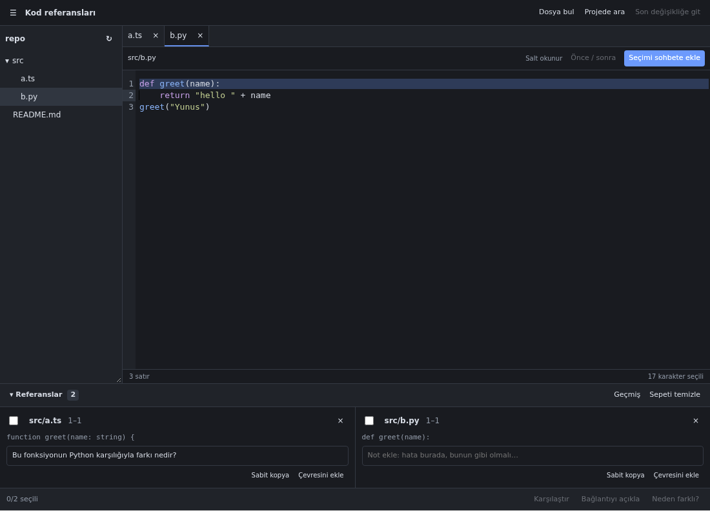

# OpenCode CodeLink

**Browse your code. Bring context into your conversation.**

CodeLink is a read-only code explorer for OpenCode Desktop. Browse project files, select the lines you want to discuss, and attach immutable code snapshots to your current chat draft. Combine selections from multiple files, add notes, and prepare comparison questions without copying code by hand.

CodeLink does not edit project files or send messages automatically. You choose the context and send the question yourself.



[Light-mode preview](docs/preview-light.png) · [Install with a prompt](#install-with-an-opencode-prompt) · [Installation](#installation) · [Usage](#usage) · [Keyboard shortcuts](#keyboard-shortcuts) · [Troubleshooting](#troubleshooting)

The screenshots use a sample project in the browser test fixture.

## Features

| Feature                         | What it does                                                                                                                                               |
| ------------------------------- | ---------------------------------------------------------------------------------------------------------------------------------------------------------- |
| **Project file explorer**       | Browse folders as needed, open nested directories, and keep several files in tabs.                                                                         |
| **Read-only code viewer**       | Read syntax-highlighted code with line numbers, text selection, and in-file search.                                                                        |
| **Right-click references**      | Select code and choose **Add reference to chat**, or use the toolbar button or shortcut.                                                                   |
| **Multi-file reference basket** | Keep selections from different files together in one conversation. Each reference includes its path and line range.                                        |
| **Reference notes**             | Add a note such as “the bug is here” or “match this behavior” to each reference.                                                                           |
| **Comparison questions**        | Select two references and prepare **Compare**, **Explain relationship**, or **Why different?** questions in the chat draft.                                |
| **Live file updates**           | Follow file changes made by OpenCode or another tool. Changed files have a marker, and you can jump to the latest change observed while the panel is open. |
| **Before / after view**         | Inspect changed sections side by side when the native OpenCode review API provides a patch.                                                                |
| **Immutable snapshots**         | Keep the exact code captured at selection time, even after the original file changes or disappears.                                                        |
| **Stale-reference detection**   | Show when a file changed after selection. Find the selected block's new position when it has one unique match; otherwise show the saved snapshot.          |
| **File and project search**     | Find files by name or search project text without leaving OpenCode.                                                                                        |
| **Reference history and links** | Return from a reference chip in the conversation to its source. Reuse recent references from **History**.                                                  |
| **Surrounding context**         | Use **Include context** to capture five additional lines before and after a selection.                                                                     |
| **Light and dark themes**       | Follow the host theme's colors, with code colors for both light and dark appearances.                                                                      |

Syntax highlighting is included for JavaScript, TypeScript, JSX, TSX, Python, JSON, HTML, CSS, Markdown, YAML, and shell scripts. Other text files open as plain text.

## Requirements and compatibility

- **OpenCode Desktop 2.2.5** is the verified host version. CodeLink uses the experimental `./gui-experimental` plugin API, so compatibility with other versions must be checked.
- **Node.js 22.18 or newer**, npm, and Git for the installation below.
- An existing project conversation in OpenCode Desktop. The panel is not available on the Home screen or in a new, uncreated conversation.
- The plugin has no OS restriction, but verification so far has been on **Linux**. macOS and Windows have not been tested on native machines.

This is a **Desktop GUI plugin**, not a terminal plugin or a VS Code extension. It does not require a separate model API key, background service, or account beyond your existing OpenCode setup.

## Install with an OpenCode prompt

Copy the following prompt into an OpenCode conversation that has terminal access to the computer running your Desktop app. OpenCode can carry out the clone, build, and registration steps for you:

```text
Please install OpenCode CodeLink into my existing OpenCode Desktop setup.

Repository: https://github.com/yunusaydogan/OpenCode-CodeLink
Internal plugin ID: opencode-code-reference

1. Read the repository's current README and package.json. Check Git, npm,
   Node.js >= 22.18, and Desktop GUI plugin support. The verified host version
   is OpenCode Desktop 2.2.5; do not upgrade or downgrade my app automatically.
   If a prerequisite is missing or the GUI API is unsupported, explain the
   exact blocker instead of claiming installation succeeded.
2. Find the global config used by this Desktop app, respecting custom config
   locations and XDG_CONFIG_HOME. Check for an existing CodeLink registration.
   Reuse its clone if present; do not create duplicate plugin entries. Do not
   overwrite local changes in an existing clone.
3. Otherwise clone the repository into a permanent user-owned location outside
   my current project, such as ~/opencode-plugins/OpenCode-CodeLink. Keep that
   directory after installation because the plugin loads from its absolute path.
4. In the clone, run npm ci and npm run build. Stop and report any failure.
5. Register it with npm run install:local, or use
   node scripts/install.mjs --config-dir "ACTUAL_GLOBAL_CONFIG_DIRECTORY"
   for a custom location. Preserve my other plugins, settings, JSONC comments,
   and config backups. For a symlinked config, explain the installer limitation
   and use the documented manual method without replacing the symlink.
6. Verify that dist/gui-experimental.cjs exists and that the config's plural
   plugins array points to this clone's absolute directory. If the running local
   OpenCode service is accessible, check that opencode-code-reference is active
   and that it serves the newly built GUI bundle. Do not print credentials.
7. Tell me the installation path, config file, backup location if one was made,
   and what was actually verified. Explain how to open + > CodeLink or use
   Ctrl+Shift+E (Cmd+Shift+E on macOS). Do not terminate the running OpenCode
   process from inside this conversation; tell me if a restart is necessary.

Perform the installation, not just a description of the steps. Do not modify
my project's source code or send any model requests to test the plugin.
```

The installing agent needs local filesystem and command access. A conversation running only on a remote server cannot install a GUI plugin into your local Desktop app without access to that computer. If you prefer to run the commands yourself, follow the installation steps below.

## Installation

### 1. Clone the repository into a permanent location

```sh
git clone https://github.com/yunusaydogan/OpenCode-CodeLink.git
cd OpenCode-CodeLink
```

Keep this directory after installation: OpenCode will load the plugin from its absolute path.

### 2. Install dependencies and build

```sh
npm ci
npm run build
```

The GUI bundle is written to `dist/gui-experimental.cjs`. A prebuilt bundle is also tracked in the repository, but rebuilding ensures it matches your checkout.

### 3. Register the plugin

```sh
npm run install:local
```

The installer:

1. Finds `opencode.json` or `opencode.jsonc` in the global OpenCode configuration directory. If both exist, it selects `opencode.json`.
2. Adds the absolute path of this repository to the **`plugins`** array.
3. Preserves other settings, existing plugins, JSONC comments, and trailing commas.
4. Creates an `opencode.json.bak-<timestamp>` or `opencode.jsonc.bak-<timestamp>` backup before changing an existing file.
5. Leaves the configuration unchanged if this path is already registered.

By default, it uses `~/.config/opencode`, or `$XDG_CONFIG_HOME/opencode` when that environment variable is set. You can specify another config directory explicitly:

```sh
node scripts/install.mjs --config-dir "/path/to/opencode-config"
```

For example, in Windows PowerShell with a custom config location:

```powershell
node scripts/install.mjs --config-dir "C:\Users\YourName\.config\opencode"
```

The installer refuses to modify a symlinked config file automatically. Use the manual method below if your config is managed through a symlink.

### 4. Open CodeLink in Desktop

1. Open an existing project conversation in OpenCode Desktop.
2. In the side panel's **+** menu, select **CodeLink**. Alternatively, press **Ctrl+Shift+E** or **Cmd+Shift+E** on macOS.
3. If the entry is missing, restart OpenCode Desktop and check **Settings → Extensions → Plugins**.

Register the plugin in the global config used by Desktop's own background server. Adding it only to a remote server's config does not install its GUI in your local Desktop app. See [OpenCode's plugin documentation](https://opencode.ai/v2/docs/plugins#desktop) for the host's loading behavior.

### Manual registration

After installing dependencies and building, add the repository's **absolute directory path** to your global config. Preserve any entries already in the array:

```jsonc
{
  "plugins": ["your-existing-plugin", "/absolute/path/to/OpenCode-CodeLink"],
}
```

On Windows, forward slashes make JSON paths easier to write:

```jsonc
{
  "plugins": ["C:/Users/YourName/Projects/OpenCode-CodeLink"],
}
```

Use the plural **`plugins`** key for this OpenCode v2 plugin. The registered path must point to the repository directory, not the `.cjs` file. For more on paths and config locations, see the official [plugin configuration](https://opencode.ai/v2/docs/plugins#configure) and [configuration guide](https://opencode.ai/v2/docs/config#locations).

The public project name is **OpenCode CodeLink**. Its internal package/plugin ID remains `opencode-code-reference` to preserve existing references, links, and stored state. Look for that ID when inspecting plugin diagnostics.

## Usage

### Add code to a conversation

1. Open a file from the tree or use **Find file**.
2. Select the code you want to discuss.
3. Right-click and choose **Add reference to chat**. You can also click **Add selection to chat** or use **Ctrl+Shift+L** / **Cmd+Shift+L**.
4. The selection appears both as a reference card and as an attachment in the current chat draft.
5. Add a note on the card if needed. Repeat with other files, write your question, and send it from OpenCode's composer.

Selections are captured as **complete lines**, including the first and last selected lines. Each attachment contains the project directory, relative file path, line range, captured code, and your note.

### Ask about two pieces of code

1. Add two references, possibly from different files.
2. Check **Select for comparison** on both cards.
3. Choose one of:
   - **Compare** — ask about similarities and differences.
   - **Explain relationship** — ask about the connection and data flow.
   - **Why different?** — ask why the two pieces behave differently.
4. Review or edit the prepared question, then send it yourself.

Existing draft text is preserved; the question is inserted into the draft. CodeLink never submits it automatically.

### Expand or inspect a reference

- **Include context** captures five more lines on each side using the current file, if the original block can be located uniquely. It replaces the basket item with a new snapshot and preserves its note. If the basket already holds 30 references, remove one before using **Include context**.
- **Snapshot** opens the saved selection, independently of whether the current file still exists.
- Click the card's path to return to the current file. If its code moved and has one unique match, CodeLink selects the new position. If it cannot locate the block reliably, it shows the snapshot instead.
- **Changed since selection** means the file changed after capture; it does not necessarily mean the selected lines changed.

### Search files and project text

- **Find file** searches file paths as you type. Pick a result to open it.
- **Search project** searches text when you press Enter or click **Search**. Results include the path, line number, and a short preview. Click a result to jump to that line.
- Use **Ctrl+F** / **Cmd+F** inside the viewer to search the open file.

Project text search is case-insensitive and searches literal text, not regular expressions. Incomplete scans and unreadable files are reported below the results.

### Review changes

Changed files have a marker in the tree. **Go to latest change** opens the latest file change observed by the panel; if no event has been observed yet, it opens an available changed file from the native review data.

Use **Before / after** when a patch is available. It shows the patch's changed sections and surrounding context, rather than reconstructing two complete historical files. Section headers identify the original line positions. Snapshot and diff views remain readable even if the current file was deleted.

### Reuse or remove references

- **History** lists up to 100 recent references for the session/project. **Add again** creates a new draft attachment from a saved snapshot.
- The **×** on a card removes it from the basket and current draft; it does not modify a sent message.
- **Clear basket** removes the basket's references from the current draft. Historical snapshots remain until the history limit is reached.
- The basket stays available after you send a message, so you can reuse it. Clear it when starting a new question.
- If you remove an attachment directly in OpenCode's composer, its basket card does not automatically disappear. Use **Add again** from history to reattach it, or remove the card as well.

Clicking a CodeLink reference chip in a conversation opens its source in the panel. References belonging to another project are identified instead of being silently opened in the current project.

## Keyboard shortcuts

| Action                       | Windows / Linux | macOS         | Scope                                                          |
| ---------------------------- | --------------- | ------------- | -------------------------------------------------------------- |
| Open CodeLink                | `Ctrl+Shift+E`  | `Cmd+Shift+E` | OpenCode command registration; requires a project conversation |
| Find file                    | `Ctrl+P`        | `Cmd+P`       | While focus is inside CodeLink                                 |
| Add selection to chat        | `Ctrl+Shift+L`  | `Cmd+Shift+L` | While focus is inside CodeLink                                 |
| Search open file             | `Ctrl+F`        | `Cmd+F`       | Inside the code viewer                                         |
| Close a menu/search/snapshot | `Esc`           | `Esc`         | While focus is inside CodeLink                                 |

The command palette also includes **CodeLink: Open panel**, **CodeLink: Find file**, and **CodeLink: Search project**. Host-level shortcuts can conflict with other plugins; the **+** menu and command palette remain available.

## Limits

| Area                             | Limit or behavior                                                                                         |
| -------------------------------- | --------------------------------------------------------------------------------------------------------- |
| Code viewer                      | Up to 2,000,000 characters; text files only                                                               |
| One reference                    | Up to 48,000 characters                                                                                   |
| Basket                           | Up to 30 references                                                                                       |
| Stored history                   | Up to 100 references, including basket items; the oldest non-basket items are pruned first                |
| File search                      | Up to 100 results                                                                                         |
| Project text search              | Up to 2,000 files and 2,000 listed directories; 512,000 bytes per file; 200 matching lines                |
| Excluded text-search directories | `.git`, `node_modules`, `vendor`, `dist`, `build`, `.next`                                                |
| Diff view                        | Requires the native OpenCode review API and an available patch                                            |
| Workspace                        | The current conversation's project root; external roots from other plugins are not automatically included |

The text-search byte limit is checked after the host returns a file; it is not a streaming download limit. Binary and non-UTF-8 files are skipped. Host filesystem/configuration rules can further restrict available files.

Old references already sent in messages retain their captured code even after pruning from the plugin's history. If the historical entry is no longer available, its link falls back to the recorded file path and original line range; relocation is then unavailable.

## Data handling

CodeLink reads files through OpenCode's native APIs. It does not write, rename, or delete project files, and it does not run shell commands or call a model itself.

References and notes are stored through OpenCode's session storage and composer. When you send a message, the captured code, paths, and notes become part of that conversation and are handled by the model/provider you selected in OpenCode. Select only the code you intend to share. CodeLink does not add a separate analytics or telemetry service.

## Updating

From the installed clone:

```sh
git pull --ff-only
npm ci
npm run build
```

The registered path stays the same, so you do not normally need to run the installer again. Local GUI bundle changes may reload automatically; restart Desktop if the old interface remains visible.

If you move the clone, replace its old absolute path in `plugins` with the new one. Do not keep two paths registered for the same plugin.

## Disabling and uninstalling

- To disable the GUI, turn off the plugin in **Settings → Extensions → Plugins**.
- To unregister it, remove this clone's path from the global `plugins` array and reload OpenCode.
- Delete the clone only after unregistering it. Removing the path does not erase references already stored in conversations.
- To undo an installer config change, review the timestamped backup before restoring it; later config edits may need to be preserved.

## Troubleshooting

| Symptom                                         | What to check                                                                                                                                             |
| ----------------------------------------------- | --------------------------------------------------------------------------------------------------------------------------------------------------------- |
| CodeLink is missing from the **+** menu         | Open an existing project conversation, confirm Desktop 2.2.5, check the global plugin registration, and restart Desktop.                                  |
| Plugin fails to load                            | Confirm the registered directory still exists, run `npm ci` and `npm run build`, and inspect its status in **Settings → Extensions → Plugins**.           |
| Installer modified the wrong config             | Use `node scripts/install.mjs --config-dir "…"` for the directory actually used by Desktop. The helper does not infer custom `OPENCODE_CONFIG` locations. |
| Installer rejects a symlink                     | Register the plugin manually in the managed config target.                                                                                                |
| **Add selection to chat** is disabled           | Select nonempty code in the current-file view. Snapshots and diff panes are for inspection.                                                               |
| References cannot be added                      | Leave shell-command mode and use a normal conversation with an available composer. Subagent views may not have one.                                       |
| The basket and draft show different attachments | Direct composer changes do not synchronize the basket. Remove the card or use **Add again** from history.                                                 |
| A changed reference cannot be relocated         | The original block was modified, removed, or appears more than once. Inspect **Snapshot** or select the current code again.                               |
| **Before / after** is unavailable               | No patch is available for this file from the native review API. OpenCode/repository review data must be present.                                          |
| Search results are incomplete                   | Check the scan limits, excluded directories, and unreadable-file count below the search input.                                                            |
| The panel still uses an older version           | Confirm the configured clone path, rebuild it, and restart Desktop. Avoid duplicate registrations.                                                        |

For an issue report, include your OS, OpenCode Desktop version, installation method, reproduction steps, and relevant error text. Remove private code and credentials before attaching logs. [Open an issue](https://github.com/yunusaydogan/OpenCode-CodeLink/issues).

## Development

```sh
npm ci
npx playwright install chromium
npm run check
```

`npm run check` runs unit/installer tests, TypeScript checking, the production build, and browser interaction tests. The browser tests use the real Solid and CodeMirror components with a simulated host adapter; they do not click through a real Desktop window.

For an isolated test against an installed OpenCode CLI:

```sh
node test/live-smoke.mjs
```

The default binary is `/opt/OpenCode/resources/opencode-cli`. Override it when needed:

```sh
OPENCODE_BIN=/absolute/path/to/opencode-cli node test/live-smoke.mjs
```

In PowerShell:

```powershell
$env:OPENCODE_BIN = "C:\path\to\opencode-cli.exe"
node test/live-smoke.mjs
```

The live test uses temporary config and storage, checks native plugin registration, verifies GUI bundle serving, and exercises file APIs. It does not send model requests or modify existing user sessions.

Regenerate the sample light/dark screenshots with:

```sh
node scripts/preview.mjs
```

### Source layout

```text
src/
  gui.tsx          Native plugin registration, commands, links, and session storage
  panel.tsx        File explorer, tabs, search, selection, and navigation
  editor.tsx       Read-only CodeMirror viewer and syntax highlighting
  basket.tsx       Reference cards, notes, history, and pair actions
  references.ts    Snapshot capture, relocation, expansion, and attachments
  paths.ts         Display names for native file/directory paths
  search.ts        Bounded project text search through native file APIs
  diff.ts          Side-by-side patch sections
  state.ts         Persisted panel state types
  styles.ts        Scoped light/dark UI styles
scripts/
  install.mjs      Config-preserving local registration
  preview.mjs      Sample screenshot generation
```

Contributions are welcome. Keep project access read-only, preserve snapshot immutability, avoid automatic prompt submission, and add a regression test for behavioral fixes. Verify changes against the pinned experimental host SDK before opening a pull request.

## License

[MIT](LICENSE).
